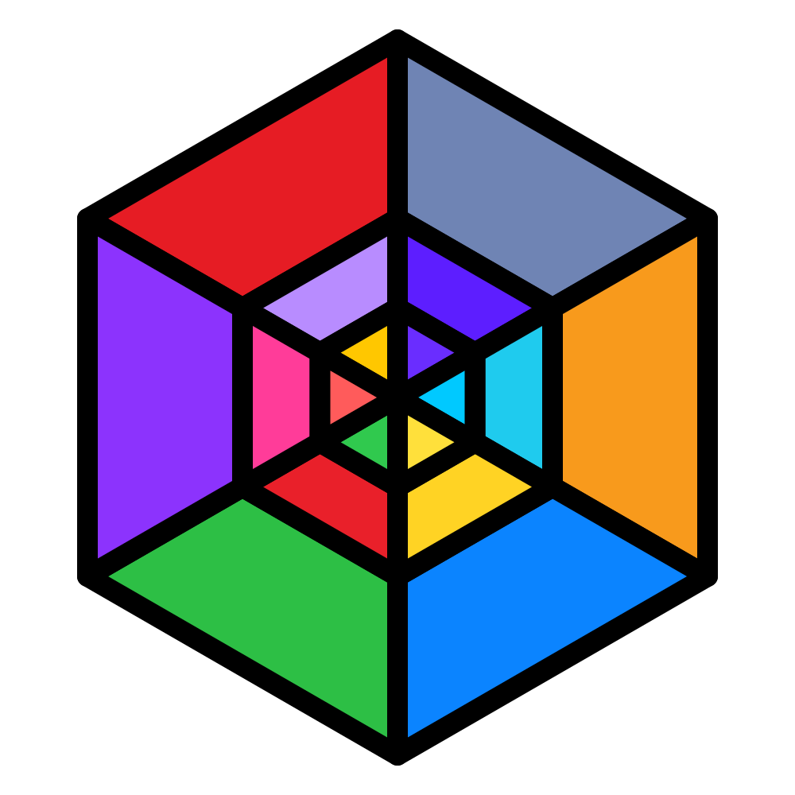

# Let's Code India

### Building the entire software world from the ground up.

**A playground for independent engineering: building original software, exploring every layer of computing, and learning together.**

---

## 🚀 About the Organization

**Let's Code India** is an open engineering collective dedicated to building software completely from scratch. We don't limit ourselves to one language, tool, or product. If it runs on code, we want to design it, understand it, and build our own version of it.

Whether it's system-level software, developer tools, custom platforms, AI models, or experimental engines, this organization is a space where ideas are built from first principles and developers learn by actually building real things.

---

## 📂 What This Repository Is

This repository holds the organization's **shared defaults**. These files are used automatically across every repository in the organization, so every project stays consistent and welcoming.

| File | What it does |
|---|---|
| [`profile/README.md`](profile/README.md) | The public profile page shown on the organization's GitHub home |
| [`CONTRIBUTING.md`](CONTRIBUTING.md) | How to contribute to any project in the organization |
| [`CODE_OF_CONDUCT.md`](CODE_OF_CONDUCT.md) | The behavior we expect from everyone who takes part |
| [`PULL_REQUEST_TEMPLATE.md`](PULL_REQUEST_TEMPLATE.md) | The default template for every pull request |
| [`.github/ISSUE_TEMPLATE/`](.github/ISSUE_TEMPLATE) | Bug report and feature request templates |
| [`LICENSE`](LICENSE) | MIT License |
| [`logo.svg`](logo.svg) | The Let's Code India logo |

---

## 🌐 Scope of Exploration

Instead of following a rigid path, we build based on curiosity, necessity, and innovation. No single area gets more weight than another. Here is what we explore, all in parallel over time:

| ⚙️ Systems & Infrastructure | 🛠️ Developer Tooling | 🧠 AI & Intelligent Systems | 🌐 Applications & Platforms |
|:---:|:---:|:---:|:---:|
| Low-level programming, operating concepts, runtimes, and core engines | Custom environments, language design, utilities, and build tools | Autonomous models, self-reliant tools, and modern algorithms | Browsers, frameworks, suite applications, and web technologies |

---

## 📦 Active Projects

| Project | Domain | Focus | Status | Activity |
|:---|:---:|:---|:---:|:---:|
| [**Mountain-Lang**](https://github.com/Let-s-Code-India/mountain-lang) | Systems | Core logic & execution framework | 🟡 In Progress |  |
| [**Mountain-Lang-Doc**](https://github.com/Let-s-Code-India/Mountain-Lang-Doc) | Docs | Documentation & specifications | 🟢 Active |  |

*New repositories and independent tools will appear here as experiments turn into active projects. This list isn't tied to any one product.*

---

## 💡 How We Work & Learn

1. **No Fixed Boundaries:** we build whatever interests us or solves a fundamental problem.
2. **First Principles Thinking:** we understand how things work under the hood by creating them ourselves.
3. **Open Collaboration:** anyone can jump into any project, learn from the codebase, suggest improvements, or build alongside us.

---

## 🤝 Contributing & Learning

Want to build or learn with us?

- **Explore:** check out our repositories to see what's brewing.
- **Participate:** open issues, share ideas in the **Discussions** tab, or send pull requests.
- **Build anything:** got an idea for a new independent software project under the organization? Let's talk.

Please read the [Contributing Guide](CONTRIBUTING.md) and the [Code of Conduct](CODE_OF_CONDUCT.md) before you start.

---

*"No boundaries, no limits, just building original software."*

