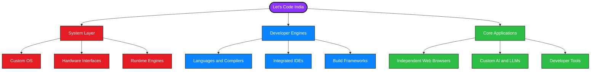

# Let's Code India

### Building the entire software world from the ground up.

  

 

[**Philosophy**](#-the-core-philosophy) &nbsp;•&nbsp; [**What We Build**](#-what-we-design--create) &nbsp;•&nbsp; [**Projects**](#-active-projects) &nbsp;•&nbsp; [**How We Work**](#-how-we-work--learn) &nbsp;•&nbsp; [**Join Us**](#-join-and-contribute)

---

## 📈 The Core Philosophy

> **"If it runs on code, we build it ourselves."**

Most software today is built on top of pre-existing frameworks, libraries, and layers of abstraction. **Let's Code India** was founded on a different path: **pure engineering**.

We don't restrict ourselves to a single language, tool, or domain. We build complete, independent digital tools from the bare ground up, learning, reverse-engineering, and innovating at every layer of computing.

| 🧱 Absolute Independence | 🔬 Deep System Mastery | 🌍 Open for Everyone |
|:---:|:---:|:---:|
| Building tools without relying on heavy external dependencies | Understanding every instruction, compiler phase, and architecture detail by writing it ourselves | A massive knowledge base where anyone can learn real engineering, contribute code, and grow |

---

## ⚡ What We Design & Create

Our work spans every corner of computer science and software development. No single area gets more weight than another; every branch below grows as curiosity and need lead us.

| ⚙️ Systems & Infrastructure | 🛠️ Developer Tooling | 🧠 AI & Intelligent Systems | 🌐 Applications & Platforms |
|:---:|:---:|:---:|:---:|
| Low-level programming, operating concepts, runtimes, and core engines | Custom environments, language design, utilities, and build tools | Autonomous models, self-reliant tools, and modern algorithms | Browsers, frameworks, suite applications, and web technologies |

---

## 💡 How We Work & Learn

| 🧭 No Fixed Boundaries | 🔍 First Principles | 🤝 Open Collaboration |
|:---:|:---:|:---:|
| We build whatever interests us or solves a fundamental problem | We understand how things work under the hood by creating them ourselves | Anyone can join any project, learn from the codebase, suggest improvements, or build alongside us |

**Learn by building.** We believe the fastest way to understand software is to build it. Start small, build real things, then go deeper, from your first program all the way to the systems underneath.

---

## 🤝 Join and Contribute

Whether you are a low-level systems programmer, an AI enthusiast, an app developer, or someone eager to learn how software works beneath the surface, **you belong here.**

- 🔍 **Explore:** check our repositories to see active engines, tools, and systems.
- 💬 **Engage:** join discussions, open issues, and share architecture ideas.
- 🛠️ **Build:** pick up any issue, submit pull requests, or propose a brand-new original project under the organization.

**Community standards:** [Contributing Guide](https://github.com/Let-s-Code-India/.github/blob/main/CONTRIBUTING.md) &nbsp;•&nbsp; [Code of Conduct](https://github.com/Let-s-Code-India/.github/blob/main/CODE_OF_CONDUCT.md) &nbsp;•&nbsp; [Pull Request Template](https://github.com/Let-s-Code-India/.github/blob/main/PULL_REQUEST_TEMPLATE.md)

---

*Driven by curiosity. Powered by code. Built without limits.*

Founded by <a href="https://github.com/ayushgiriai21-cmd">Ayush Giri</a>

